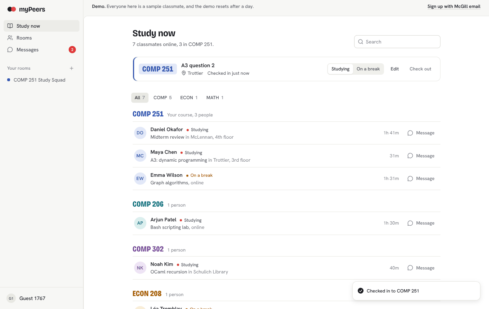
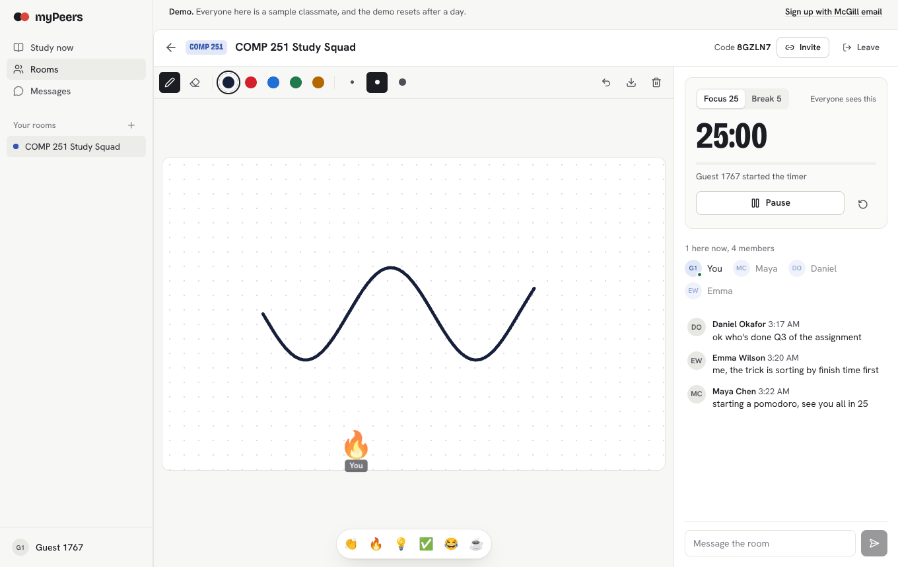
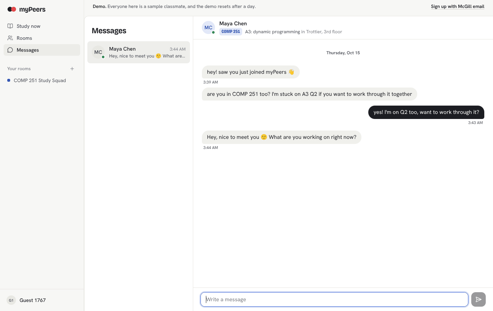
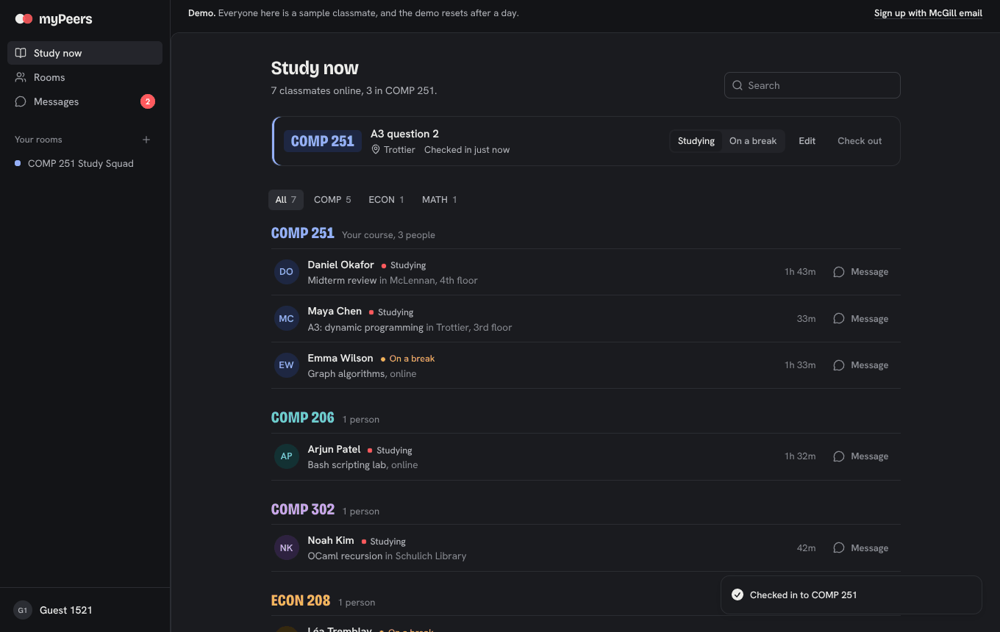
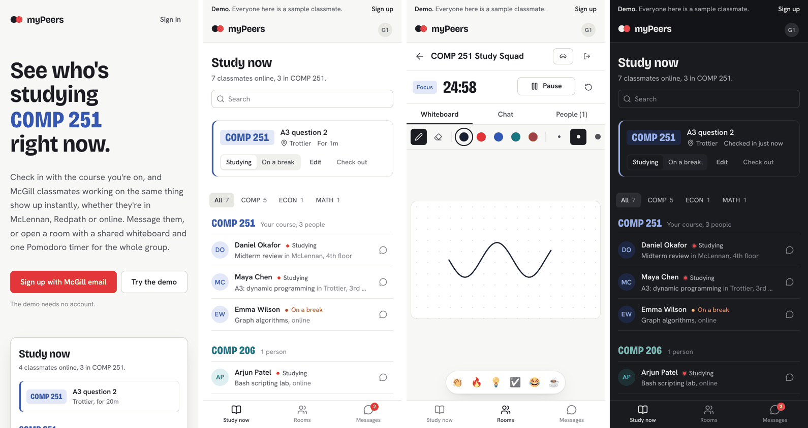
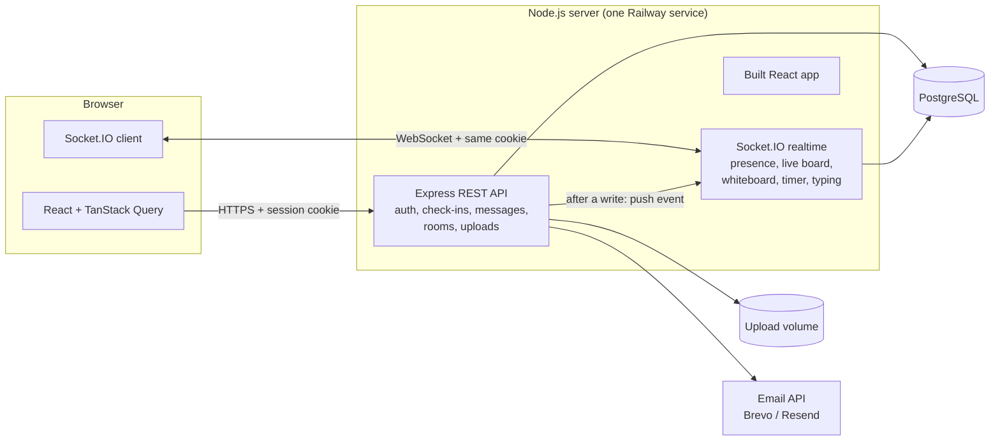

# myPeers

**See which McGill classmates are studying your course right now, message them, and study together in live rooms.**

You check in with the course you're working on (say `COMP 251`), what you're doing and where. Everyone else who's checked in shows up instantly, grouped by course, with yours at the top. From there you can message someone, share notes, or open a study room with a shared whiteboard and one Pomodoro timer the whole group follows.

> **Live: [mypeers-production.up.railway.app](https://mypeers-production.up.railway.app)**. No account needed: press **Try the demo**. It drops you into a sandbox with sample classmates, an unread message and a study room, so you can see every feature in about two minutes.


| Studying now | Study room |
|---|---|
|  |  |

| Messages | Dark mode |
|---|---|
|  |  |



## Features

- **Live board.** Classmates appear and disappear the moment they check in, check out or close the tab. No refresh, no polling.
- **McGill-only accounts.** Sign up with an `@mail.mcgill.ca` address and confirm it with a 6-digit emailed code. Password reset works the same way.
- **Direct messages** with read receipts, typing indicators, and image/PDF sharing that only the two people in the chat can open.
- **Study rooms** with a six-letter invite code, a shared whiteboard, a synced Pomodoro timer, group chat, who's-here-now, and emoji reactions.
- **Demo mode** for people without a McGill email, fully isolated from real users.
- Dark mode, mobile layout, keyboard and screen-reader support, reduced-motion support.

## Architecture



One Node process serves the React app, the REST API and the WebSocket server on the same origin, backed by Postgres.

**Durable writes go through REST, live updates go through the socket.** Sending a message is a `POST`; once the row is saved, the server pushes a `dm:new` event to the recipient's open tabs. Fast, throwaway things (drawing, typing indicators, reactions, timer buttons) go straight over the socket. On reconnect, the client refetches what it might have missed.

### Design decisions worth knowing

| Problem | Decision | Why |
|---|---|---|
| Who is online? | Presence = "has an open socket", tracked in memory with a 30s grace period | The first version wrote a heartbeat to the DB every 10s per user and every client re-queried the whole list on each one, which grows with the square of the number of users. |
| Shared Pomodoro timer | The server stores only `endsAt` (a timestamp). Each client counts down locally, corrected for clock skew. | No per-second network traffic, everyone's timer hits zero together, and it survives a tab closing. Pure functions in `server/src/realtime/timer.ts`, unit tested. |
| Whiteboard on different screens | Points are stored as fractions (0 to 1) of a fixed 16:10 board | Pixel coordinates put a laptop drawing in the wrong place on a phone. |
| Login | Random token in an `httpOnly`, `SameSite=Lax` cookie; the DB stores only its SHA-256 hash | JavaScript can't read the token, and a leaked database can't be used to log in. |
| CSRF | SameSite cookies plus an `Origin` check on every write | Browsers always send `Origin` on cross-site writes. |
| Email codes | Hashed, expire in 15 minutes, burned after 5 wrong guesses, 45s resend cooldown | A 6-digit code can't be brute forced. |
| File sharing | Random filename on disk, type checked by magic bytes, served only to the sender and recipient, images served with a sandbox CSP | A file named `.png` that is really HTML can't run in our origin. |
| Demo mode | Separate "world": demo users only see demo users and demo rooms, guests are deleted after 24h | Recruiters can try everything without ever seeing or touching real student data. |

**Scaling note.** Presence and room state live in one process's memory, which is right for a single instance. Running several instances would need the Socket.IO Redis adapter and a shared presence store.

## Tech stack

- **Frontend:** React 19, TypeScript, Vite, Tailwind CSS 4, React Router, TanStack Query, Radix UI primitives, Socket.IO client
- **Backend:** Node.js 22, Express 5, Socket.IO, PostgreSQL via `pg` with hand-written SQL migrations, zod validation, bcrypt, helmet, pino
- **Testing:** Vitest + Supertest against a real Postgres, plus Socket.IO integration tests (39 tests)
- **Ops:** Docker, Railway

## Run it locally

You need Node 22 and Postgres. The quickest way to get Postgres:

```bash
docker run -d --name mypeers-db -e POSTGRES_USER=mypeers -e POSTGRES_PASSWORD=mypeers -e POSTGRES_DB=mypeers -p 5432:5432 postgres:16
```

Then:

```bash
git clone https://github.com/vipulmodi0304/mypeers.git
cd mypeers
cp .env.example .env
npm install
npm run dev
```

Open http://localhost:5173. The database schema is created automatically on first start. In development, verification codes are printed in the terminal instead of emailed.

### Tests

```bash
docker exec mypeers-db createdb -U mypeers mypeers_test   # once
npm test
```

## Deploying

See [docs/DEPLOY.md](docs/DEPLOY.md) for step-by-step Railway instructions (Postgres, a volume for uploads, environment variables, email).

## Project structure

```
server/
  migrations/      SQL schema, applied in order on startup
  data/            McGill course catalogue (searched server-side)
  src/
    auth/          sessions (cookies) and email codes
    routes/        REST endpoints: auth, me, check-ins, messages, uploads, rooms
    realtime/      Socket.IO server, presence, timer and whiteboard logic
    services/      peers (visibility rules) and demo mode
web/src/
  pages/           landing, auth, study now, messages, rooms, room, profile
  components/      UI primitives, app shell, whiteboard, timer, chat
  lib/             API client, socket provider, auth and data hooks
tests/             API, realtime and logic tests
docs/              design notes, deployment guide, screenshots
```

## History

The first version was a 48-hour hackathon MVP built on Supabase (still in the commit history). It was used by 15 to 20 students but had real problems: student IDs visible to every user, a polling design that wouldn't scale, half-wired features, and no tests. Version 2 is a rebuild with its own Node backend, a proper security model, realtime by WebSocket, and a redesigned interface.

---

Built by [Vipul Modi](https://www.linkedin.com/in/vipul-modi-883003219/). Not affiliated with McGill University.
